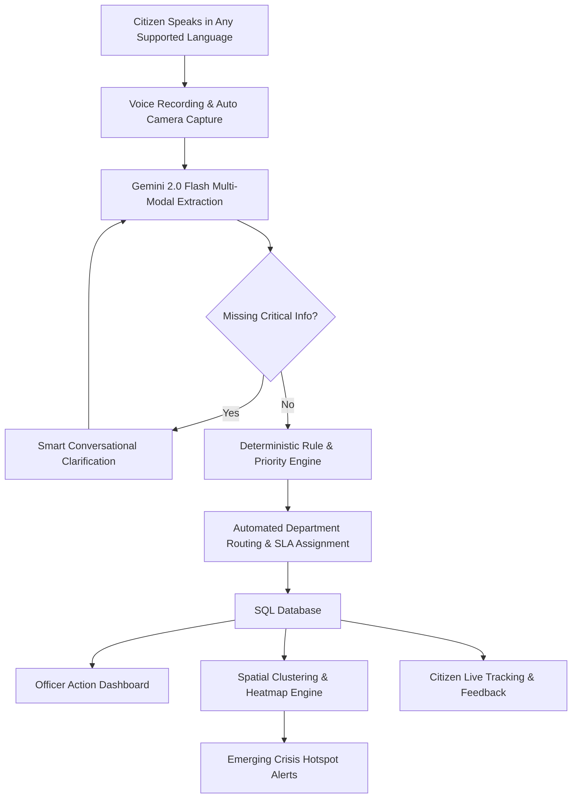

# 🏛️ OurVoice
### *Our Voice. Our Issue. Towards the Right Solution.*
> **AI-Powered Multilingual Voice Governance & Community Intelligence Platform**

[](https://nextjs.org/)
[](https://react.dev/)
[](https://fastapi.tiangolo.com/)
[](https://www.python.org/)
[](https://ai.google.dev/)
[](https://tailwindcss.com/)
[](https://opensource.org/licenses/MIT)

---

## 🌟 Overview

**OurVoice** is an AI-powered multilingual governance and community intelligence platform built to bridge the gap between citizens and public administration. Traditional grievance portals force citizens to navigate complex bureaucratic menus, creating significant digital and language literacy barriers.

**OurVoice** replaces traditional forms with a natural, voice-first AI engine. Citizens can simply speak in their preferred language. The system converts speech to structured data, verifies live camera evidence, attaches geolocation proofs, deterministically assigns priority SLAs, routes tickets to appropriate departments, and clusters data to detect emerging public infrastructure crises in real time.

```
"AI proposes, deterministic rules validate, and humans act."
```

---

## 🌐 Multilingual Support

OurVoice is engineered to support regional dialects and official languages across India:

| Language | Code | Speech Recognition | AI Understanding | Audio Synthesis |
|---|---|---|---|---|
| **English** | `en` | ✅ Supported | ✅ Supported | ✅ Supported |
| **Tamil** | `ta` | ✅ Supported | ✅ Supported | ✅ Supported |
| **Hindi** | `hi` | ✅ Supported | ✅ Supported | ✅ Supported |
| **Telugu** | `te` | ✅ Supported | ✅ Supported | ✅ Supported |
| **Kannada** | `kn` | ✅ Supported | ✅ Supported | ✅ Supported |
| **Malayalam** | `ml` | ✅ Supported | ✅ Supported | ✅ Supported |
| **Bengali** | `bn` | ✅ Supported | ✅ Supported | ✅ Supported |
| **Urdu** | `ur` | ✅ Supported | ✅ Supported | ✅ Supported |

---

## 🚀 Key Features

### 🎙️ 1. Multilingual Voice-First Intake
* **Natural Speech Understanding**: Understands regional accents, colloquial phrasing, and mixed-language speech (e.g., Tanglish, Hinglish).
* **Instant Speech Recognition + Multi-Modal Fallback**: Uses browser-native SpeechRecognition combined with Google Gemini 2.0 Flash for audio and intent extraction.
* **Multi-Issue Decomposition**: When a citizen mentions multiple distinct issues in a single voice recording (e.g. broken road and water supply disruption), the system splits them into separate departmental tickets automatically.

### 📸 2. Verified Evidence & Automatic Geo-Tagging
* **Mandatory Live Camera Capture**: Automatically activates the camera after voice recording to capture real-time photo evidence.
* **Automated Geolocation & IP Stamp**: Gathers GPS coordinates, reverse-geocodes exact street addresses, and logs network IP verification proofs.

### ❓ 3. Proactive Smart Clarification
* If essential routing details are missing (e.g., exact landmark, duration, or severity), the AI asks concise, single-question follow-ups in the citizen's chosen language before submission.

### 🛡️ 4. Deterministic SLA & Priority Engine
* Employs strict, auditable scoring rules (eliminating LLM hallucinations) to assign priority levels (`CRITICAL`, `HIGH`, `MEDIUM`, `LOW`) based on hazard type, historical recurrences, and population impact.
* **Autonomous SLA Monitor**: An automated background worker monitors resolution deadlines and escalates delayed tickets.

### 🗺️ 5. Geospatial Cluster & Heatmap Intelligence
* Vector embeddings cluster complaints spatially to detect anomalous public infrastructure hotspots (e.g., 40+ complaints in a 2km radius flagged as an **Emerging Water Scarcity Cluster**).
* Interactive MapLibre heatmap visualization for administrative officers and municipal commissioners.

### 💡 6. Proactive Welfare Scheme Discovery
* Identifies when a citizen grievance is a request for government assistance and matches them to relevant central and state welfare schemes with instant eligibility assessment.

### 👥 7. Officer & Citizen Portals
* **Citizen Tracking**: Live status tracker with end-to-end milestone progression (`CREATED` ➔ `CLASSIFIED` ➔ `ROUTED` ➔ `IN_PROGRESS` ➔ `RESOLVED` ➔ `CITIZEN_CONFIRMED`).
* **Officer Dashboard**: 2x2 action matrix, priority queues, resolution workflows, and citizen feedback loop.

---

## 🏗️ Architecture & Pipeline



---

## 💻 Tech Stack

| Domain | Technology | Purpose |
|---|---|---|
| **Frontend Framework** | **Next.js 16.3** (App Router, Turbopack) | High-performance SSR and static web architecture |
| **UI & Styling** | **React 19**, **Tailwind CSS 4**, Lucide Icons | Clean, responsive civic governance theme |
| **Mapping Engine** | **MapLibre GL**, **React-Map-GL** (Client-Only SSR-Safe) | Interactive geospatial heatmaps & cluster visualization |
| **Backend API** | **FastAPI 0.115** (Python 3.12) | High-performance asynchronous REST backend |
| **AI & Multi-Modal LLM** | **Google Gemini 2.0 Flash** (`google-genai`) | Voice transcription, entity extraction, scheme matching |
| **Database & ORM** | **SQLAlchemy 2.0**, SQLite (Dev) / PostgreSQL (Prod) | Structured grievance lifecycle management |
| **Security & Auth** | JWT (`python-jose`), Passlib Bcrypt | Role-based officer & admin access control |

---

## 📂 Project Structure

```
├── backend/
│   ├── app/
│   │   ├── api/             # REST Routers (auth, voice, grievances, intelligence, schemes)
│   │   ├── core/            # Priority engine, SLA monitor, scheme matcher, AI extractors
│   │   ├── db/              # Database models, connection & initial seeding
│   │   ├── rules/           # Deterministic routing & priority rule definitions
│   │   ├── config.py        # Environment configuration
│   │   └── main.py          # FastAPI application entry point
│   ├── Dockerfile           # Backend containerization
│   ├── render.yaml          # Render deployment manifest
│   └── requirements.txt     # Python dependencies
│
├── frontend/
│   ├── app/
│   │   ├── citizen/         # Citizen intake, status tracking, schemes discovery
│   │   ├── officer/         # Officer dashboard, grievance resolution, community intelligence
│   │   ├── admin/           # Administrative analytics & SLA monitor
│   │   ├── components/      # Isolated SSR-safe dynamic map modules
│   │   ├── layout.tsx       # Root layout with multilingual typography
│   │   └── page.tsx         # Interactive landing hero & feature pipeline
│   ├── lib/                 # API client & multilingual (i18n) configs
│   ├── package.json         # Dependencies & scripts
│   └── next.config.ts       # Next.js build configuration
│
└── README.md
```

---

## ⚡ Quick Start Guide

### Prerequisites
- **Node.js**: `v20.x` or higher
- **Python**: `3.10` - `3.12`
- **Google Gemini API Key**: [Get a free key from Google AI Studio](https://aistudio.google.com/)

---

### 1. Backend Setup

```bash
# Navigate to backend directory
cd backend

# Create and activate virtual environment
python -m venv .venv
# On Windows:
.venv\Scripts\activate
# On Linux/macOS:
# source .venv/bin/activate

# Install Python dependencies
pip install -r requirements.txt

# Configure environment variables
cp .env.example .env
```

Edit `backend/.env` with your settings:
```env
GEMINI_API_KEY=your_gemini_api_key_here
CORS_ORIGINS=http://localhost:3000
SECRET_KEY=your_random_secret_key
DATABASE_URL=sqlite:///./nammakural.db
```

```bash
# Start the FastAPI server
python -m app.main
```
> Backend API: `http://localhost:8000`  
> Interactive Docs: `http://localhost:8000/docs`

---

### 2. Frontend Setup

```bash
# Open a new terminal and navigate to frontend
cd frontend

# Install Node dependencies
npm install

# Start the Next.js development server
npm run dev
```
> Frontend Application: `http://localhost:3000`

---

## ☁️ Deployment

### 🌐 Deploy Frontend to Vercel
1. Import repository on [Vercel](https://vercel.com/new).
2. Set **Root Directory** to `frontend`.
3. Add Environment Variable:
   - `NEXT_PUBLIC_API_URL` = `https://<your-backend-api-url>`
4. Deploy!

### 🐳 Deploy Backend to Render / Docker
```bash
docker build -t ourvoice-backend ./backend
docker run -p 8000:8000 --env-file ./backend/.env ourvoice-backend
```

---

## 👥 Demo Officer Credentials

| Role | Username | Password | Access Level |
|---|---|---|---|
| **Water Supply Officer** | `officer_water` | `water123` | Water supply & sanitation issues |
| **Highways & Roads Officer** | `officer_roads` | `roads123` | Roads, potholes & infrastructure |
| **Electricity Board Officer** | `officer_elec` | `elec123` | Power outages & transformers |
| **System Administrator** | `admin` | `admin123` | Full analytics, SLA monitor & system config |

---

## 📜 License

This project is licensed under the MIT License — see the [LICENSE](LICENSE) file for details.

---

<div align="center">
  <sub>Built with ❤️ for Citizen Empowerment & Responsible AI Governance.</sub>
</div>
