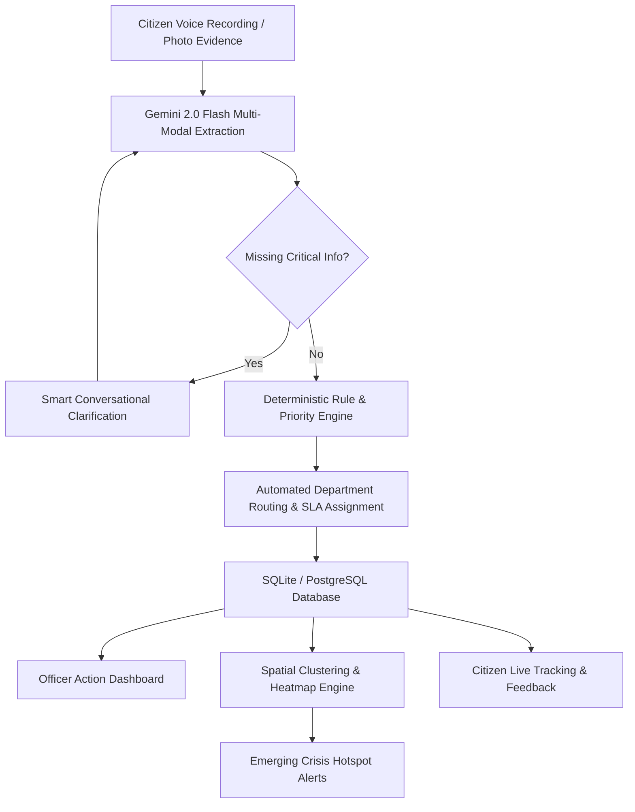

# 🏛️ OurVoice (நம்ம குரல்)
### *Our Voice. Our Issue. Towards the Right Solution.*
> **AI-Powered Multilingual Voice Governance & Community Intelligence Platform**

[](https://nextjs.org/)
[](https://react.dev/)
[](https://fastapi.tiangolo.com/)
[](https://www.python.org/)
[](https://ai.google.dev/)
[](https://tailwindcss.com/)
[](https://opensource.org/licenses/MIT)

---

## 🌟 Overview

**OurVoice** is a transformative civic intelligence layer designed for Indian e-governance. Traditional grievance portals force citizens through rigid bureaucratic forms, creating digital literacy barriers. **OurVoice** replaces this with a conversational, voice-first AI engine that listens to citizens in their native tongue, structures and verifies the issue, captures real-time evidence, routes to the right department, and uncovers emerging community-wide crises before they escalate.

```
"AI proposes, deterministic rules validate, and humans act."
```

---

## 🚀 Key Features

### 🎙️ 1. Multilingual Voice-First Grievance Intake
* **Native Dialect Understanding**: Speaks and processes Tamil, English, Hindi, Telugu, Kannada, Malayalam, Bengali, and Urdu.
* **Instant Speech Recognition + Multi-Modal Fallback**: Uses browser-native speech synthesis coupled with Google Gemini 2.0 Flash for audio extraction.
* **Multi-Issue Decomposition**: If a citizen complains about both broken roads and water cuts in one recording, the AI splits them into distinct tickets routed to separate departments (e.g., Highways vs. TWAD Board).

### 📸 2. Verified Evidence & Automatic Geo-Tagging
* **Live Camera Proof**: Mandatory real-time camera capture prevents fake stock-photo submissions.
* **Automated Geolocation & IP Stamp**: Captures device GPS coordinates, reverse-geocodes exact street addresses, and logs citizen IP proofs.

### ❓ 3. Proactive Smart Clarification
* If essential routing details are missing (e.g. duration, landmark, or specific locality), the AI asks concise, single-question follow-ups in the citizen's native language before final submission.

### 🛡️ 4. Deterministic SLA & Priority Engine
* Uses strict, auditable scoring rules (not LLM hallucination) to calculate urgency scores (CRITICAL, HIGH, MEDIUM, LOW) based on hazard type, historical recurrences, and population impact.
* **Autonomous SLA Monitor**: Background task monitors deadlines and triggers escalations if unattended.

### 🗺️ 5. Geospatial Cluster & Heatmap Intelligence
* Embeds grievances using vector models to detect anomalous spatial clusters (e.g., 50 complaints within a 2km radius in 48 hours flagged as an **Emerging Water Crisis**).
* Interactive MapLibre heatmap visualization for district collectors and department heads.

### 💡 6. Proactive Welfare Scheme Discovery
* Connects grievances to Tamil Nadu state & central government welfare schemes (e.g., *Kalaignar Kanavu Illam*, Chief Minister's Solar Scheme) with instant eligibility matching.

### 👥 7. Complete Officer & Citizen Portals
* **Citizen Tracking**: Real-time status tracker with timeline progression (`CREATED` ➔ `CLASSIFIED` ➔ `ROUTED` ➔ `IN_PROGRESS` ➔ `RESOLVED` ➔ `CITIZEN_CONFIRMED`).
* **Officer Dashboard**: 2x2 action matrix, priority queues, resolution workflows, and citizen feedback loop.

---

## 🏗️ Architecture & Pipeline



---

## 💻 Tech Stack

| Domain | Technology | Purpose |
|---|---|---|
| **Frontend Framework** | **Next.js 16.3** (App Router, Turbopack) | Modern, fast SSR & static web architecture |
| **UI & Styling** | **React 19**, **Tailwind CSS 4**, Lucide Icons | Responsive civic governance theme |
| **Mapping Engine** | **MapLibre GL**, **React-Map-GL** (Client-Only SSR-Safe) | Interactive geospatial heatmaps & cluster maps |
| **Backend API** | **FastAPI 0.115** (Python 3.12) | High-performance async REST backend |
| **AI & Multi-modal LLM** | **Google Gemini 2.0 Flash** (`google-genai`) | Voice transcription, entity extraction, scheme matching |
| **Database & ORM** | **SQLAlchemy 2.0**, SQLite (Dev) / PostgreSQL (Prod) | Structured grievance lifecycle management |
| **Security & Auth** | JWT (`python-jose`), Passlib Bcrypt | Role-based officer & admin access control |

---

## 📂 Project Structure

```
├── backend/
│   ├── app/
│   │   ├── api/             # REST Routers (auth, voice, grievances, intelligence, schemes)
│   │   ├── core/            # Priority engine, SLA monitor, scheme matcher, AI extractors
│   │   ├── db/              # Database models, connection & initial seeding
│   │   ├── rules/           # Deterministic routing & priority rule definitions
│   │   ├── config.py        # Environment configuration
│   │   └── main.py          # FastAPI application entry point
│   ├── Dockerfile           # Backend containerization
│   ├── render.yaml          # Render deployment manifest
│   └── requirements.txt     # Python dependencies
│
├── frontend/
│   ├── app/
│   │   ├── citizen/         # Citizen intake, status tracking, schemes discovery
│   │   ├── officer/         # Officer dashboard, grievance resolution, community intelligence
│   │   ├── admin/           # Administrative analytics & SLA monitor
│   │   ├── components/      # Isolated SSR-safe dynamic map modules
│   │   ├── layout.tsx       # Root layout with multilingual typography
│   │   └── page.tsx         # Interactive landing hero & feature pipeline
│   ├── lib/                 # API client & multilingual (i18n) configs
│   ├── package.json         # Dependencies & scripts
│   └── next.config.ts       # Next.js build configuration
│
└── README.md
```

---

## ⚡ Quick Start Guide

### Prerequisites
- **Node.js**: `v20.x` or higher
- **Python**: `3.10` - `3.12`
- **Google Gemini API Key**: [Get a free key here](https://aistudio.google.com/)

---

### 1. Backend Setup

```bash
# Navigate to backend directory
cd backend

# Create and activate virtual environment
python -m venv .venv
# On Windows:
.venv\Scripts\activate
# On Linux/macOS:
# source .venv/bin/activate

# Install Python dependencies
pip install -r requirements.txt

# Configure environment variables
cp .env.example .env
```

Edit `backend/.env` with your settings:
```env
GEMINI_API_KEY=your_gemini_api_key_here
CORS_ORIGINS=http://localhost:3000
SECRET_KEY=your_random_secret_key
DATABASE_URL=sqlite:///./nammakural.db
```

```bash
# Start the FastAPI server
python -m app.main
```
> Backend API: `http://localhost:8000`  
> Interactive Docs: `http://localhost:8000/docs`

---

### 2. Frontend Setup

```bash
# Open a new terminal and navigate to frontend
cd frontend

# Install Node dependencies
npm install

# Start the Next.js development server
npm run dev
```
> Frontend Application: `http://localhost:3000`

---

## ☁️ Deployment

### 🌐 Deploy Frontend to Vercel
1. Import repository on [Vercel](https://vercel.com/new).
2. Set **Root Directory** to `frontend`.
3. Add Environment Variable:
   - `NEXT_PUBLIC_API_URL` = `https://<your-backend-api-url>`
4. Deploy!

### 🐳 Deploy Backend to Render / Docker
```bash
docker build -t ourvoice-backend ./backend
docker run -p 8000:8000 --env-file ./backend/.env ourvoice-backend
```

---

## 👥 Demo Officer Credentials

| Role | Username | Password | Access Level |
|---|---|---|---|
| **TWAD Officer** | `officer_water` | `water123` | Water supply & sanitation issues |
| **Highways Officer** | `officer_roads` | `roads123` | Roads, potholes & infrastructure |
| **TANGEDCO Officer** | `officer_elec` | `elec123` | Power outages & transformers |
| **System Admin** | `admin` | `admin123` | Full analytics, SLA monitor & system config |

---

## 📜 License

This project is licensed under the MIT License — see the [LICENSE](LICENSE) file for details.

---

<div align="center">
  <sub>Built with ❤️ for Citizen Empowerment & Responsible AI Governance.</sub>
</div>
